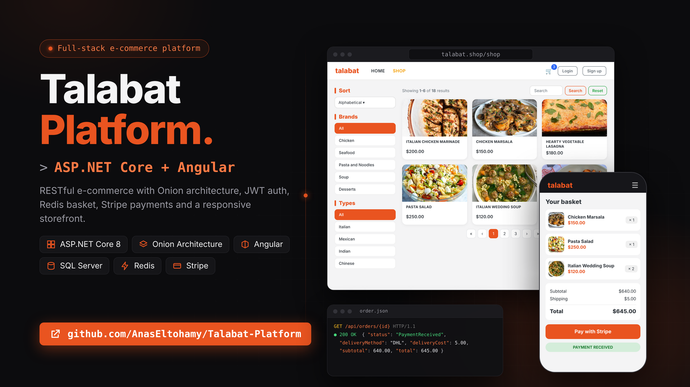
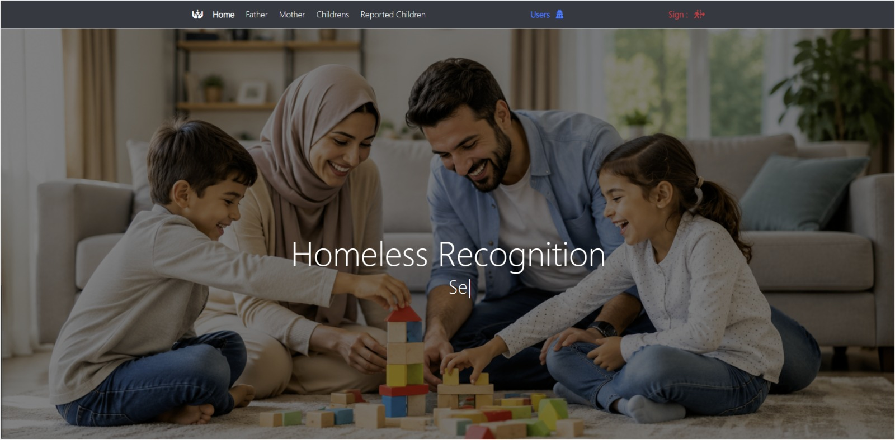
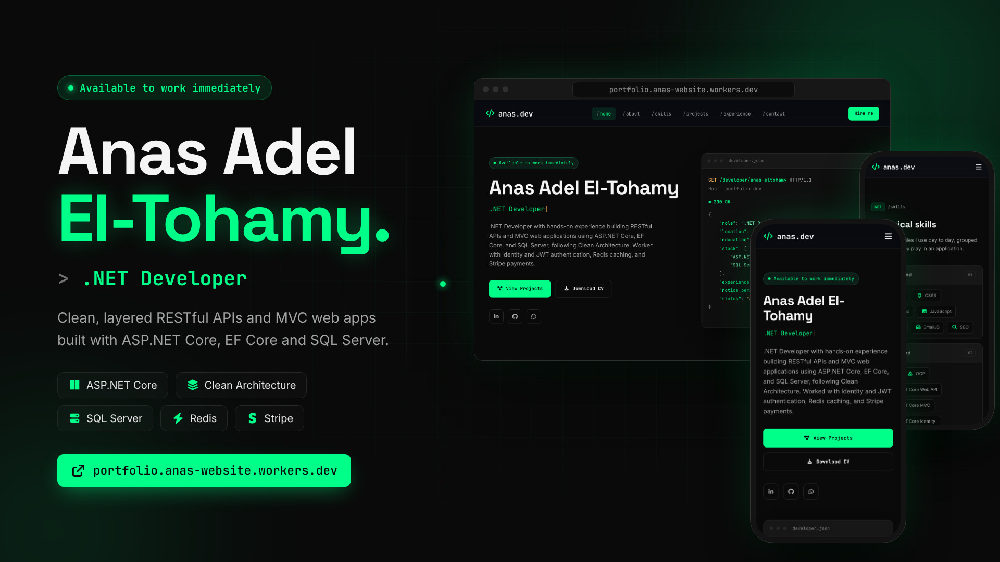

# Hi, I'm Anas Adel Eltohamy 
 
**.NET Developer** based in Cairo, Egypt. I build RESTful APIs and MVC web applications with ASP.NET Core, EF Core, and SQL Server, following Clean Architecture.
 
## What I do
 
- Design and build backend APIs with authentication (ASP.NET Core Identity + JWT), clean layered architecture, and well-structured data access.
- Integrate online payments with Stripe, including server-side price calculation and webhooks.
- Build full web applications with ASP.NET Core MVC.
- Deliver freelance websites for clients in the Gulf region.
## Tech stack
 
**Backend:** C# · ASP.NET Core Web API · ASP.NET Core MVC · Entity Framework Core · ASP.NET Core Identity · JWT · AutoMapper · LINQ · Redis · Stripe
 
**Architecture & patterns:** Onion / Clean Architecture · Repository · Unit of Work · Specification pattern
 
**Databases:** SQL Server
 
**Frontend:** HTML · CSS · JavaScript · Bootstrap · jQuery
 
**Tools:** Git · GitHub · Visual Studio · Postman · Swagger
 
## Featured projects
 
### [Talabat Platform](https://github.com/AnasEltohamy/Talabat-Platform)
 

A RESTful e-commerce backend built with ASP.NET Core 8 and Onion Architecture, integrated with an Angular storefront. It includes JWT authentication with Identity and roles, a filterable, sortable and paginated product catalog, a Redis-backed basket with response caching, an order workflow with delivery methods, and Stripe payments with a verified webhook that updates the order status.
 
`ASP.NET Core 8` · `EF Core` · `SQL Server` · `Redis` · `Stripe` · `JWT`
 
### [National ID Family Search App](https://github.com/AnasEltohamy/National-ID-Family-Search)
 

A CRUD web application built with ASP.NET Core MVC and Identity to search people by National ID and view their parents' details and images. I led a team of 7 and owned the backend development, from database design to the application layers.
 
### [Portfolio](https://portfolio.anas-website.workers.dev/)
 

My personal portfolio website: [portfolio.anas-website.workers.dev](https://portfolio.anas-website.workers.dev)
 
## Education
 
- Bachelor's Degree in Computer Science, The Egyptian University of E-Learning (EELU), 2020 – 2024
- Full Stack .NET Diploma, Rout Academy, 2024
## Let's connect
 
- LinkedIn: [anasadeleltohamy](https://www.linkedin.com/in/anasadeleltohamy/)
- Email: anaseltohamy015@gmail.com
- Portfolio: [portfolio.anas-website.workers.dev](https://portfolio.anas-website.workers.dev)
 
